<div align="center">


# Anatomu

**Explore the human body in 3D, right in your browser.**
Over 2,100 real anatomical structures in 7 layers, with names, Latin terms and descriptions. Free, no sign-up, works on phones.

[](https://anatomu.vercel.app)
[](LICENSE)
[](package.json)


<a href="https://anatomu.vercel.app">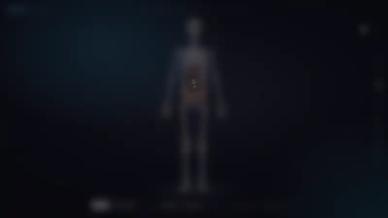</a>

**[▶ Open the app](https://anatomu.vercel.app)** · **[Watch the full demo video (MP4, 1080p)](docs/media/demo.mp4)** · **[How it works](#how-the-tricky-parts-work)**

</div>

---

## At a glance

| | |
| --- | --- |
| **Structures** | About 2,130 bones, muscles, organs, vessels, nerves and glands, plus about 420 whole organs and joints made of several pieces |
| **Layers** | Skeleton, Muscles, Organs, Vessels, Nerves, Reproductive, Endocrine |
| **Info panel** | Name, Latin name (TA2), system; for most parts (about 1,670) a description, with structure, function and nerve supply where the source has them |
| **Bodies** | Male, and a female view with female pelvis, reproductive organs and breasts |
| **Devices** | Desktop (mouse and keyboard) and phones (touch, bottom-sheet panel) |
| **Download** | About 9 MB for all layers; each layer loads only when you turn it on |
| **Backend** | None. A static site with no accounts or analytics; your browser only remembers the Male/Female choice and that you've seen the tips |

## Features

<table>
<tr>
<td width="50%" valign="top">

### Click any part

The rest of the body turns to faint glass, the camera glides to the part, and a panel opens with its name, Latin name, description and sections.

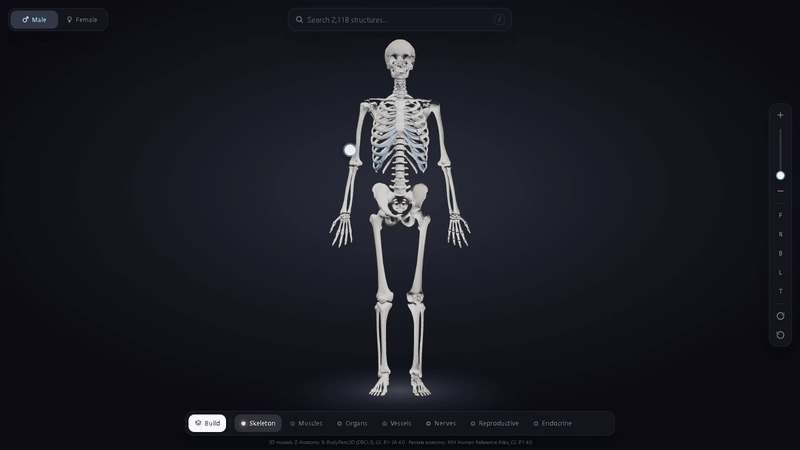

</td>
<td width="50%" valign="top">

### Select whole organs

The heart is 17 pieces. **Ctrl+click** (Cmd+click on a Mac) selects the whole heart; the glow shows what you'll get before you click.

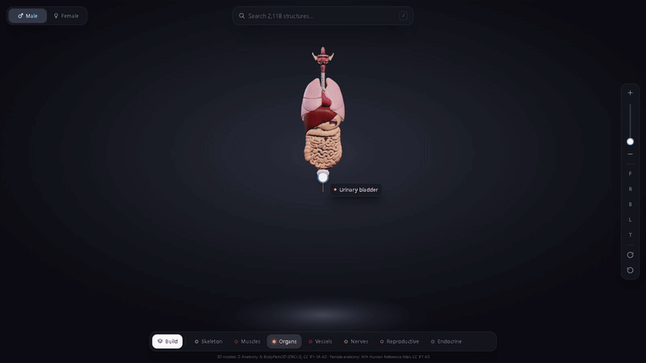

</td>
</tr>
<tr>
<td valign="top">

### Search everything

Type "heart" or "knee" to get the whole organ or joint, or any of the 2,100+ single parts. Press `/` to start.

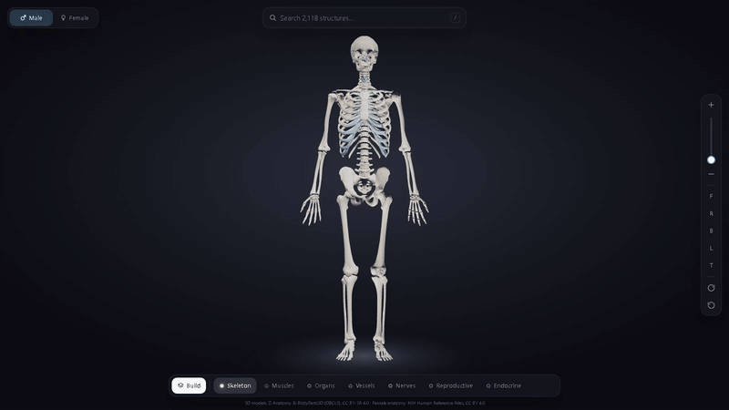

</td>
<td valign="top">

### Seven layers

Bones, organs, vessels, nerves, muscles, reproductive and endocrine. Turn them on and off in any mix.

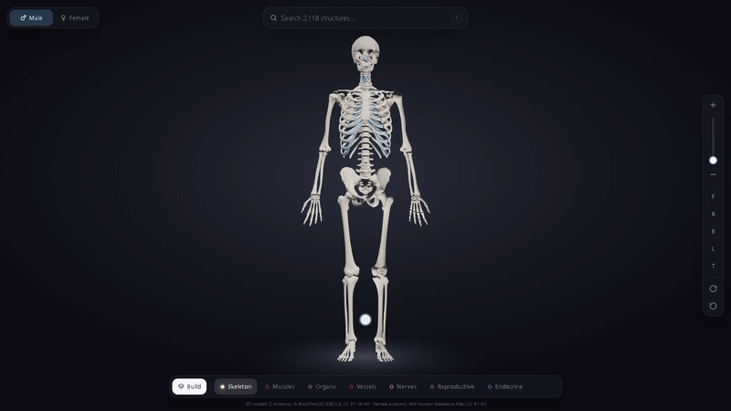

</td>
</tr>
<tr>
<td valign="top">

### Zoom to the cursor

The wheel (or a pinch) zooms toward whatever is under the pointer, so you can go straight into the face or a foot. A slider shows how close you are.

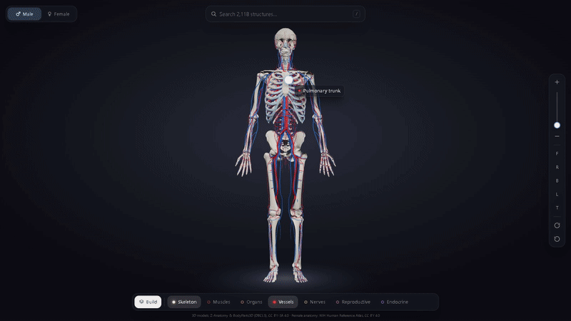

</td>
<td valign="top">

### Build mode

Assembles the body layer by layer, each layer sweeping up from the feet.

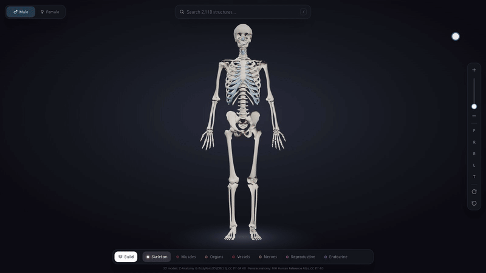

</td>
</tr>
<tr>
<td valign="top">

### Male and female

Switch to swap the pelvis, reproductive organs, breasts and bladder. The rest of the body is shared ([details](#whats-in-it)).

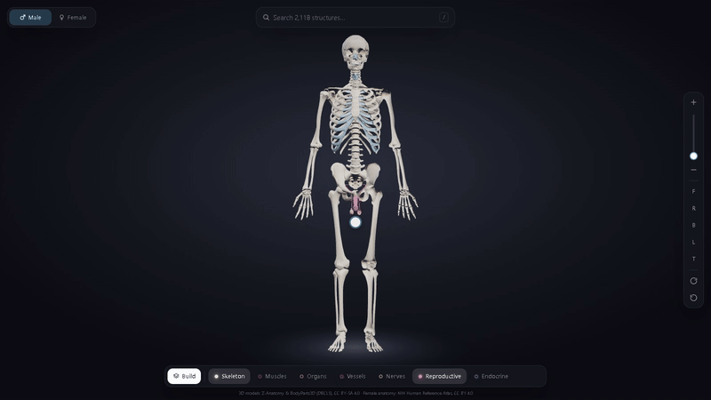

</td>
<td valign="top" align="center">

### Phones too

Tap, pinch and search; the panel becomes a bottom sheet.

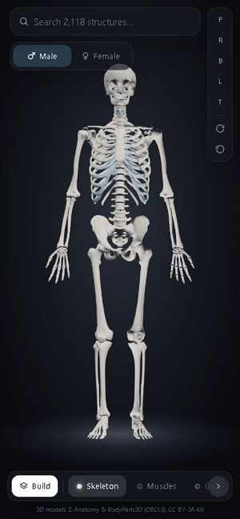

</td>
</tr>
</table>

### Screenshots

| | |
| --- | --- |
| 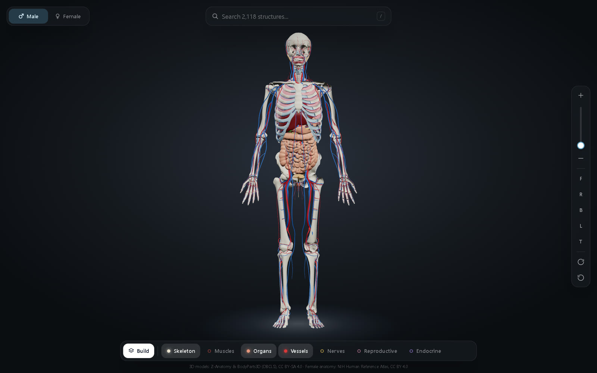 | 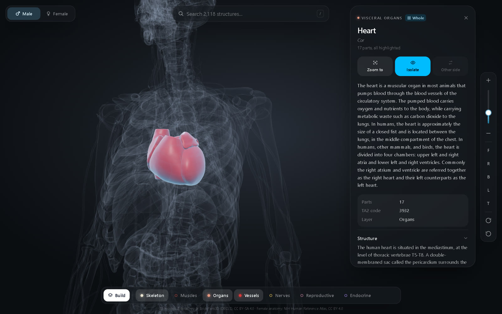 |
| Skeleton, organs and vessels | The whole heart, with its 17 parts |
| 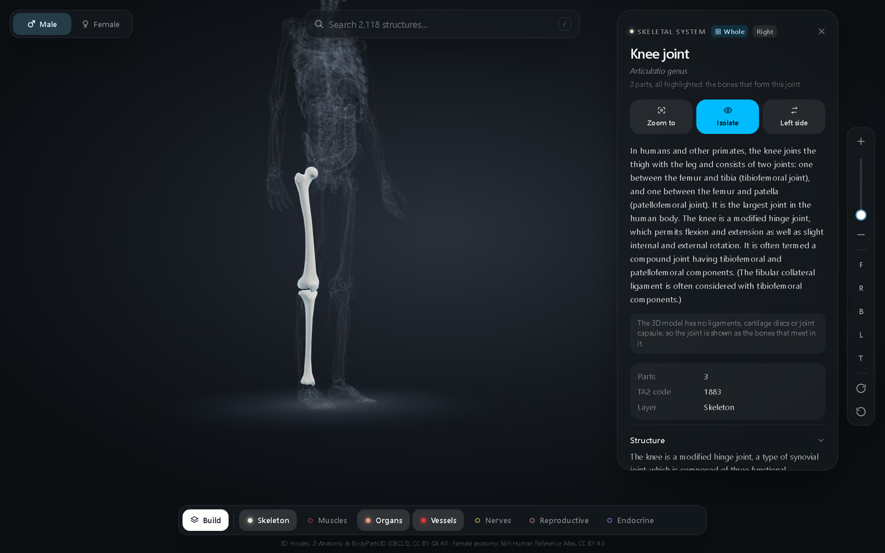 | 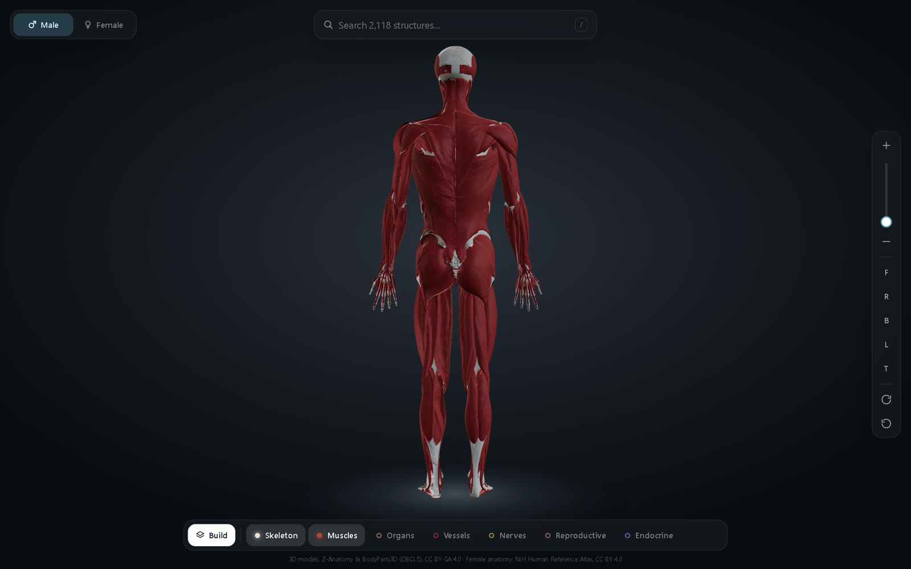 |
| The knee joint (the bones that meet in it) | Muscles, back view |
| 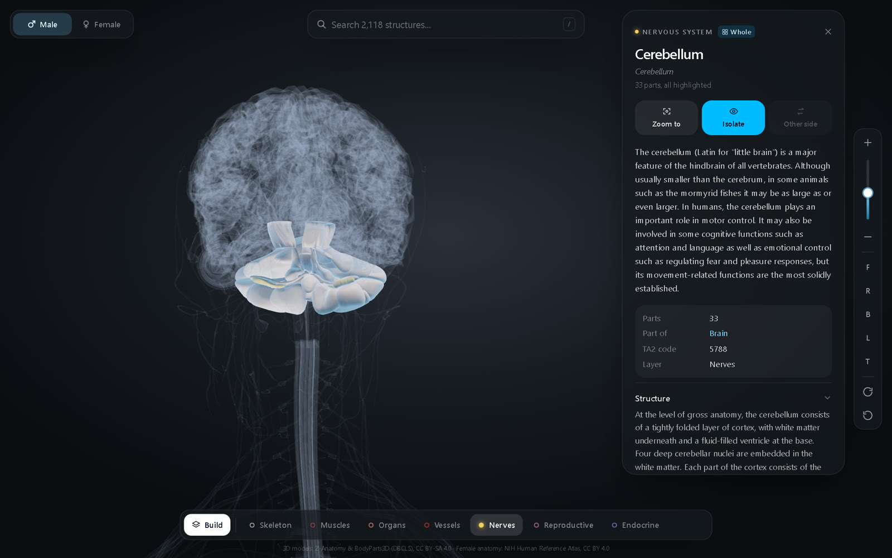 | 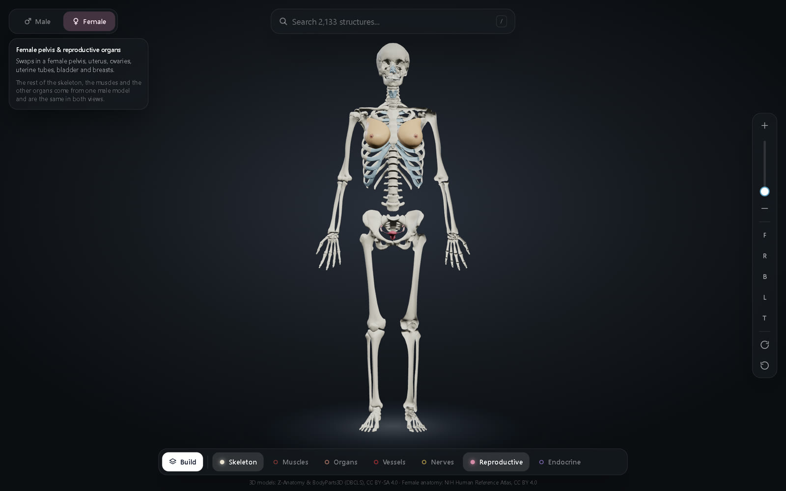 |
| Cerebellum, with the nervous system | Female view, reproductive layer |
| 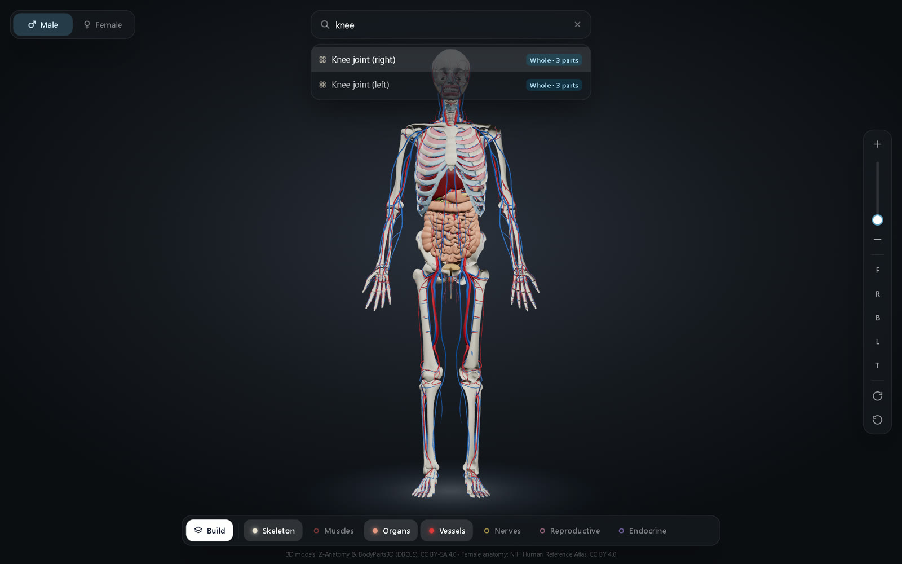 | 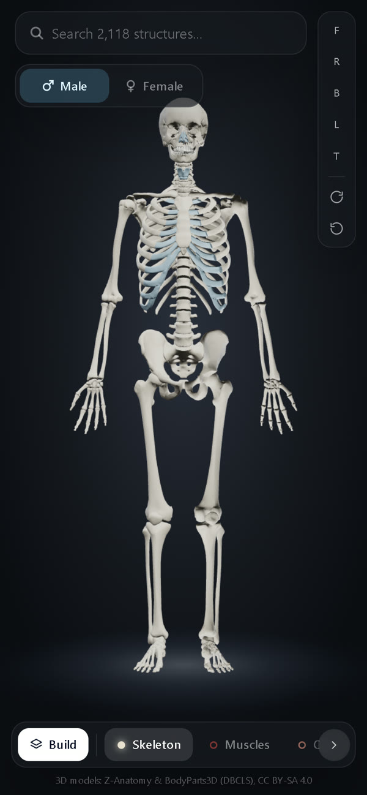 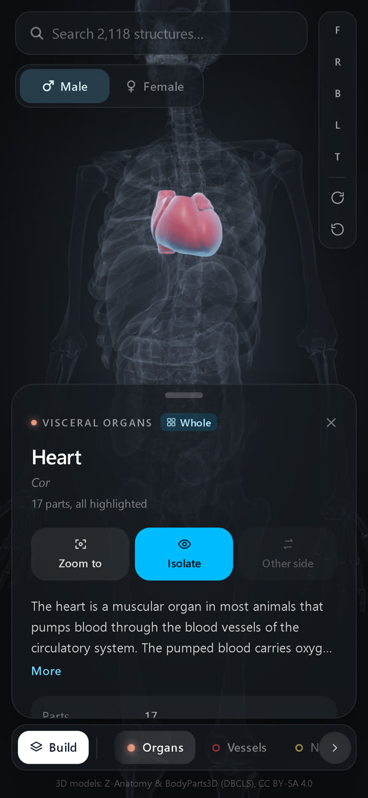 |
| Search results: whole joints first | On a phone |

> **Accuracy.** The models are real anatomical meshes (Z-Anatomy / BodyParts3D, NIH Human Reference Atlas), not drawn by hand. Descriptions are Wikipedia text; clinical paragraphs are kept apart and marked "Not reviewed". This is a learning tool, not a medical reference. Known limits are listed below.

---

## What's in it

- **7 layers**: Skeleton, Muscles, Organs, Vessels, Nerves, Reproductive, Endocrine. Each
  downloads the first time you turn it on (about 9 MB for all of them).
- **Natural colours**: arteries red, veins blue, cartilage blue-grey, liver dark red, and so on.
- **Hover** (desktop) shows a name tag and a soft glow. **Click / tap** selects a structure:
  the rest of the body turns to faint glass so the selection stands out, and the camera
  glides to it.
- **Info panel** (side panel on desktop, bottom sheet on phones):
  - the name, the Latin name and the system;
  - a description, plus Structure, Function, Nerve supply, Clinical significance and similar
    sections where available;
  - group, the structure it is part of, TA2 code;
  - **Zoom to**, **Isolate / Show all**, and **Left / Right side** to jump to the twin;
  - "Nearby" chips to hop to related structures.
- **Whole structures** (the heart, a hip bone, the knee joint...). Most organs are made of
  several pieces (the heart has 17: chambers, valves, papillary muscles), so a normal click
  selects one piece. To get the whole thing:
  - **Ctrl+click** (Cmd+click on a Mac) any piece. Ctrl+click again inside the selection to go
    one level up (a valve leaflet → the valve → the heart). While Ctrl is held, the hover glow
    and name tag show what a click would select.
  - On a phone (or with the mouse), use the **Select whole …** button in the info panel.
  - **Search** finds whole structures too ("heart", "knee"), marked "Whole · N parts".

  All pieces glow, the rest turns to glass, and the panel shows the description of the whole
  organ, its parts (tap one for its own details), and Zoom to / Isolate / other side. The
  wholes come from Z-Anatomy's own folders and "part of" links (about 420 with two or more parts, split into right
  and left where the parts come in pairs). **Joints** (knee, hip, ankle, shoulder, elbow, wrist)
  are shown as the bones that meet in them, because the model has no ligaments, menisci or
  joint capsules; the panel says so.
- **Build**: assembles the body layer by layer (bones → organs → vessels → nerves →
  muscles), each sweeping up from the feet.
- **Toolbar**: zoom (+ / − and a zoom slider), Front / Right / Back / Left / Top views,
  turntable, reset. The slider (desktop) runs from the whole body at the bottom to as close
  as allowed at the top, follows wheel and pinch zooms, and also takes the arrow keys or the
  mouse wheel when the pointer is over it.
- **Search** about 2,130 structures; picking one turns its layer on and flies there.
- **Male / Female switch** (top-left; under the search bar on phones). It swaps only these
  parts:
  - the pelvic bones (the female pelvis is wider and shallower);
  - the reproductive organs: uterus, ovaries and uterine tubes, or testes, prostate and penis;
  - the breasts (fatty tissue, gland lobes, ducts, nipple and areola);
  - the bladder.

  **It is not a full female body.** The rest of the skeleton (skull, femurs and so on), all
  muscles and the other organs come from one male model and are the same in both views. The
  app says this when you switch. Search and the info panel only list parts in the current
  view, and the choice is remembered.
- **Clinical significance** sections are Wikipedia text that no doctor has reviewed. They are
  collapsed, listed last and marked "Not reviewed".

### Shortcuts

| Key | Action |
| --- | --- |
| `/` or `Ctrl+K` | Search |
| `Ctrl`+click (`Cmd`+click on Mac) | Select the whole structure; again to go one level up |
| `1`–`5` | Front, Right, Back, Left, Top view |
| `+` / `-` | Zoom |
| `0` | Reset view |
| `A` | Turntable on/off |
| `Space` | Hold and drag: pan (hand tool). It does nothing else |
| `Esc` | Leave Isolate, then close the panel |

Mouse: left-drag orbits; right-drag or wheel-button drag pans (hand tool); the wheel zooms
toward whatever is under the cursor. Touch: one finger orbits; two fingers pinch-zoom toward
the point between them, and pan.

### Performance

Tested in headless Chrome with a 412×915 phone viewport, 4× CPU throttling, the production
build and all 7 layers on (male and female parts loaded): a camera drag averaged 10.8 ms per
frame (about 93 fps).

Load time, same throttling, fresh browser, production build (`npm run build` + `npx vite preview`):

| | Before | After |
| --- | --- | --- |
| Body visible, desktop 1280×800 | 3.6–3.7 s | 2.5–2.7 s |
| Body visible, phone 412×915 | 3.4–3.7 s | 2.5–2.7 s |
| Clicks work | same moment | about 0.2 s after the body appears |
| Turning on another layer | 1–2 s | 0.3–0.7 s |

Re-measured after adding whole structures: body visible at 2.6–3.0 s (phone) and 2.9–3.2 s
(desktop) on this machine. Building the whole-structure list takes about 30 ms and finishes
long before the skeleton model is decoded, so it doesn't delay the body; the spread is
run-to-run variation of the test machine.

The model file itself arrives in about 0.3 s; the rest is decoding and preparing it. The dev
server (`npm run dev`) is slower than this because React runs every setup step twice in
development.

The test machine has an integrated AMD laptop GPU. A real mid-range phone still needs a check.

Stack: Vite + React + TypeScript, three.js via @react-three/fiber + drei, Tailwind CSS,
zustand. It is a static site with no backend.

## Run it

```bash
npm install
npm run dev
```

Open http://localhost:5173. On a phone, use the "Network" URL Vite prints, with the phone on
the same Wi-Fi.

For a production build, run `npm run build`. The output goes to `dist/` and can be deployed to
any static host.

## Re-export the 3D models

The files in `public/models/` are already built. You only need this step if you change the
export script.

1. Download `Z-Anatomy.zip` from https://github.com/Z-Anatomy/Models-of-human-anatomy and
   unzip it so this file exists: `source_models/Z-Anatomy/Startup.blend`.
2. For Latin names, save Terminologia Anatomica 2 (TA2) as `source_models/ta/TA2.csv`. This is
   optional; without it the panel shows no Latin names or TA2 codes.
3. For the female body, download these Human Reference Atlas files into `source_models/hra/`.
   Without them, the Female view only hides the male parts.
   - From https://github.com/hubmapconsortium/ccf-releases/tree/main/v1.2/models:
     - `VH_F_Pelvis.glb`
     - `VH_F_Uterus.glb`
     - `VH_F_Ovary_L.glb` and `VH_F_Ovary_R.glb`
     - `VH_F_Fallopian_Tube_L.glb` and `VH_F_Fallopian_Tube_R.glb`
     - `VH_F_Urinary_Bladder.glb`
   - From `https://cdn.humanatlas.io/digital-objects/ref-organ/mammary-gland-female-left/v1.1/assets/3d-vh-f-mammary-gland-l.glb`,
     saved as `VH_F_Mammary_Gland_l.glb`.
   - The same for `right` / `-r`, saved as `VH_F_Mammary_Gland_r.glb`.
4. Install Blender 4.5 LTS, then run this from the project root:

```bash
"C:/Program Files/Blender Foundation/Blender 4.5/blender.exe" -b source_models/Z-Anatomy/Startup.blend --python scripts/export_models.py -- --out public/models
```

It writes, for each layer:

- `<layer>.glb`: the Draco-compressed mesh, with the original Z-Anatomy object names kept;
- `info/<layer>.json`: description, sections, Latin name, group and nerve supply;
- `index.json`: every structure name, the body's bounds, and the whole structures
  (`scripts/groups.py`);
- `info/groups.json`: descriptions of the whole structures.

Options:

- `--layers vessels,nerves` re-exports only those layers.
- `--budget-scale 0.7` makes everything lighter.

What goes into each layer, and its triangle budget, is set in `LAYERS` at the top of the
script.

## How the tricky parts work

- **One mesh per layer** (`src/viewer/mergeLayer.ts`). Each layer is merged into one mesh so
  a phone draws a few objects instead of thousands. Every vertex stores which structure it
  came from (`partId`) and its colour.
- **Glow, isolate, focus and Build** (`src/viewer/anatomyMaterial.ts`). A shader patch reads
  `partId` and looks it up in a small texture with one pixel per structure (selected?
  hovered?), so a whole heart of 17 pieces is selected with one texture update. It uses that to:
  - glow the hovered or selected structures;
  - hide everything but the isolated selection;
  - cut each layer off at a moving height during Build.

  A second "glass" pass draws the faint see-through body in focus mode.
- **Click detection** (`src/viewer/Picker.tsx`). A ray through the pointer finds the hit
  triangle, and its `partId` names the structure. A BVH keeps this fast. Taps are told apart
  from drags and pinches.
  - **Forgiving taps:** a thin bone seen whole-body on a phone is only a few pixels wide. If
    the exact point hits nothing, rings of points 4, 8 and 12 px around the finger are
    tried (4 and 8 px for a mouse), and the closest ring with a hit wins.
  - The canvas sets `touch-action: none`, so the browser never turns a touch into a page
    scroll (which would cancel the tap), and tap length is timed from the touch itself, so
    a busy page doesn't turn a quick tap into a "long press".
  - **The BVH is built in a Web Worker** (`src/viewer/bvh.worker.ts`). Building it took about
    1 s of main-thread time on a throttled phone, so the body now appears first and clicks
    start working a moment later. It is built in "indirect" mode, which leaves the
    triangle order alone, so the mesh on the GPU is untouched.
  - Clicking the 3D view takes the keyboard back from the search box, so shortcuts work
    right away.
- **Camera** (`src/viewer/CameraRig.tsx`). This uses camera-controls.
  - Wheel and pinch zoom go toward the cursor / fingers, so you can zoom straight into the
    head or a foot. The orbit centre moves with the zoom but is boxed inside the body, which
    keeps orbiting stable.
  - Pan ("hand" tool): right-drag, wheel-button drag, or hold Space and drag.
  - The near clipping plane moves with the zoom. A fixed, very close one wasted depth
    precision, and surfaces less than ~1 mm apart (vessels on muscle, cartilage on bone)
    flickered against each other while orbiting the whole body.
  - Fly-to picks a distance from the structure's size (for a whole structure, all its parts) and approaches from the side it is on.
  - The view is shifted so the structure is not hidden behind the info panel.
- **Male / Female** (`scripts/female_parts.py`, `src/viewer/mergeLayer.ts`).
  - Z-Anatomy is built from one male body, and its female folders are empty. The female
    parts come from the NIH Human Reference Atlas (Visible Human female), a different
    person, so they are fitted onto our skeleton:
    - **Pelvis:** one uniform scale and shift puts the female hip sockets on our femoral
      heads. The uterus, ovaries, tubes and bladder use the same transform, so they stay
      exactly where they are inside that pelvis.
    - **Breasts:** they are centred over the 2nd to 6th ribs, tilted to the lean of our
      chest, and rested on the chest muscles.
  - Every vertex stores whether it is male-only, female-only or shared, and the shader
    hides the other body's parts. Both versions download once, so switching is instant.
  - The female parts on a male frame are an approximation for learning, not one real
    person.
- **Descriptions** (`scripts/export_models.py`, `describe`). These come from the Wikipedia
  texts bundled in the Z-Anatomy file. Only anatomy sections are kept, and texts that are
  clearly about something else are dropped.
  - **Clinical text stays in the "Not reviewed" section.** Wikipedia often puts clinical
    material under anatomy headings (the femur's "Fractures" sits under "Function"). The
    exporter moves clinical sub-sections, and any other paragraph using clinical words
    (fracture, surgery, treatment, syndrome, disease, injury, diagnosis…), into
    "Clinical significance". In the intro it works sentence by sentence, so the opening
    definition stays. The word list is `scripts/clinical_terms.py`.
  - Check it with `python scripts/scan_clinical.py`, which prints every clinical sentence
    found outside that section and exits with an error if there is any.
    `reports/clinical-scan-before.txt` (144 sentences in 117 structures) and
    `reports/clinical-scan-after.txt` (0) are the reports from this change.

## Source data fixes

Mistakes found in the Z-Anatomy data and how they are handled:

- A mitral (left) valve leaflet was filed as part of the tricuspid (right) valve. Fixed in
  `PART_OF_FIXES` (`scripts/export_models.py`).
- Broken or abbreviated names: "????????" and "?x" (shown as unnamed cardiac vein / artery,
  not guessed), "Lat_Fis-ant-Vertical" and similar (branches of the lateral sulcus), a stray
  quote in "Central canal'" (the source has the spinal cord's central canal twice). See
  `SOURCE_NAME_FIXES` in `src/names.ts`.
- Left-over wiki markup in three descriptions ("((cn}}", "== Volar branch =="), now removed by
  the exporter's text clean-up.
- Some group "descriptions" in the source are just lists of the parts ("Mandible. Hyoid
  bone."); they are dropped, since the panel lists the parts anyway.

## Next version

- Stand / Walk / Run poses (needs a rigged skeleton).

## Credits and license

The **source code** is MIT-licensed (`LICENSE`). The **anatomy data** in `public/models/` is
not: it keeps the licenses of its sources, listed below and in full in `NOTICE`.

3D models: **Z-Anatomy** (https://www.z-anatomy.com/) and **BodyParts3D**, © The Database
Center for Life Science (DBCLS), licensed **CC BY-SA 4.0**
(https://creativecommons.org/licenses/by-sa/4.0/). The exported files are derived works and
are shared under the same license.

Female anatomy (pelvis, uterus, ovaries, uterine tubes, breasts, bladder): **NIH Human
Reference Atlas** 3D reference organs, made from the Visible Human female,
https://humanatlas.io/3d-reference-library, licensed **CC BY 4.0**.

Descriptions: Wikipedia (CC BY-SA), as bundled with Z-Anatomy. Latin names and codes:
Terminologia Anatomica 2 (FIPAT).

Z-Anatomy's license file says a few models were adapted from sources with non-commercial
licenses:

- "Kidney" by Lissie Cowley, CC BY-NC 4.0;
- the inner ear, University of Dundee, CC BY-NC-SA 4.0.

Check this before any commercial use.
